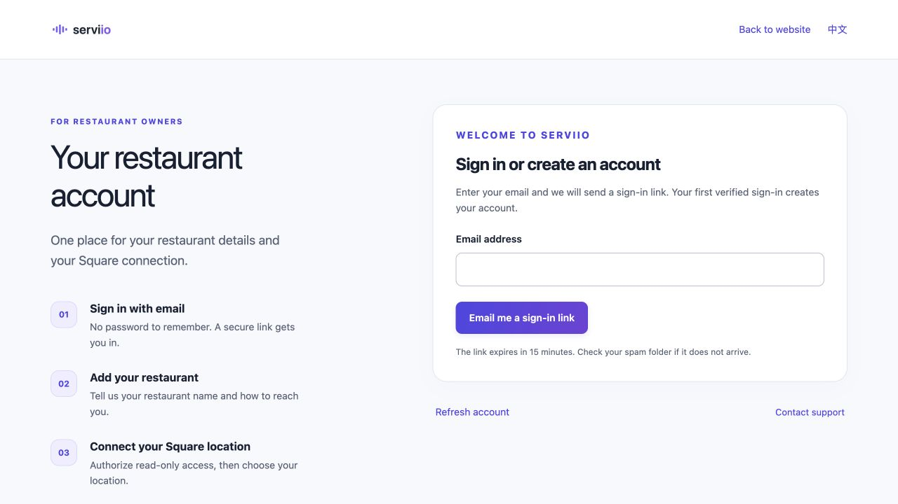
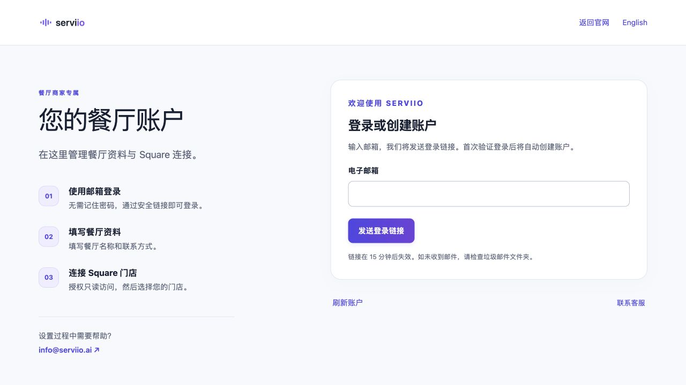

# Local implementation verification

Date: 2026-11-12
Branch: `feature/square-restaurant-onboarding`

Implemented English and Chinese account pages, email-link signup/sign-in, restaurant profiles, scoped Square OAuth, location selection, status and disconnect, encrypted credentials, token renewal and signed revocation handling. Prepared operations guidance, environment examples and a Marketplace application draft. Initial Square permission is `MERCHANT_PROFILE_READ`; menu synchronization and order submission are outside this release.

## Evidence

- Account suite: 65 tests passed, no failures. Includes real SQLite storage and mocked outbound providers. Test cases cover link expiry and replay, account isolation, OAuth state/session binding, ownership collisions, active-location validation, encrypted tokens, renewal leases, delayed callbacks and revocation/disconnect races.
- Existing SEO validator, its regression suite and deployment-anchor regression suite passed. Public SEO inventory remains 137 pages and 137 sitemap URLs. Private account pages remain noindex and outside the sitemap.
- Default build produces 155 allowlisted public files in `public-dist`. Private server modules, migrations, tests, documentation and configuration are excluded. Pages Functions compilation passed with Wrangler 4.161.0.
- Cloudflare local Workerd and D1 executed the actual migration and bundled API. A synthetic challenge was redeemed once, replay failed, authenticated restaurant data persisted, logout invalidated the session, and missing email/Square configuration returned unavailable responses. This used local-only synthetic records and no external delivery or authorization requests.
- Local HTTP checks passed for both account screens and their assets, account privacy headers, cross-origin mutation rejection and private-file exclusion. Browser review covered both languages, explicit confirmation, recoverable errors, preserved inputs, profile controls and narrow-screen layout with mocked services.
- Dependency audit after compatible development dependency updates reported zero vulnerabilities. The CSS build still emits an informational outdated Browserslist database notice.
- An independent code review identified lifecycle races during development. Version/session conditions, guarded disconnect convergence and fresh renewal claim clocks now have regression coverage. Final review found no unresolved material issue within its offline scope.

## Screenshots

These are local sign-in screen captures with empty inputs. They contain no credentials or merchant data and do not establish provider readiness.

## Still required before launch

Configure an isolated preview database, verified sending domain and scoped email secret, Square application and API version, redirect and signed webhook, encryption key, scheduled Worker and operational monitoring. Run the real email and Square Sandbox checks in `sandbox-verification.md`. Use `public-dist` as the Pages output before any authorized push or deployment. Qualify production independently.

Marketplace submission still needs verified applicant/company facts, Square App ID, adoption evidence, approved public privacy/terms documents and provider test evidence. Its draft and proposed reviewer procedure are in `marketplace-application.md`. Marketplace acceptance is controlled by Square.

No cloud resources were created, production settings changed, website pushed or deployed, emails sent, real merchant accounts connected, orders submitted, or Marketplace application submitted by this implementation.
